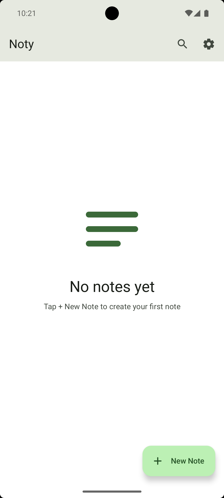
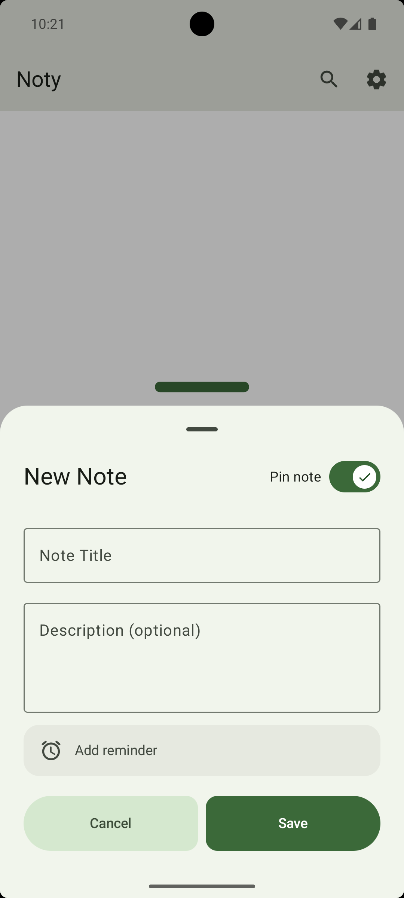
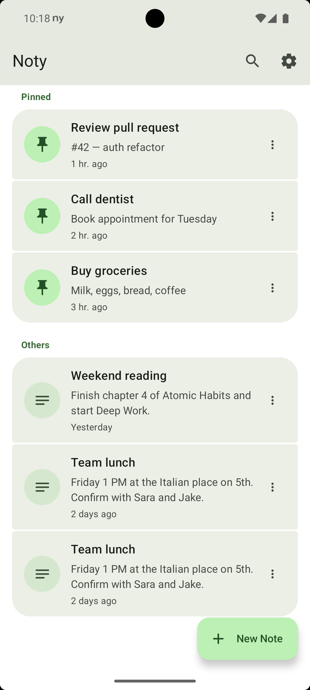
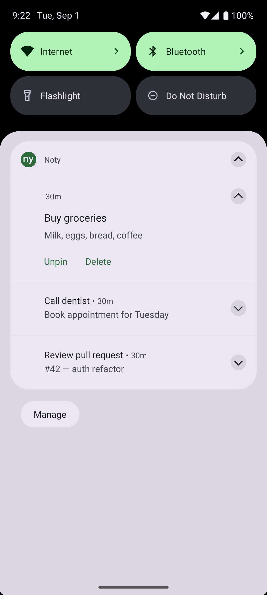
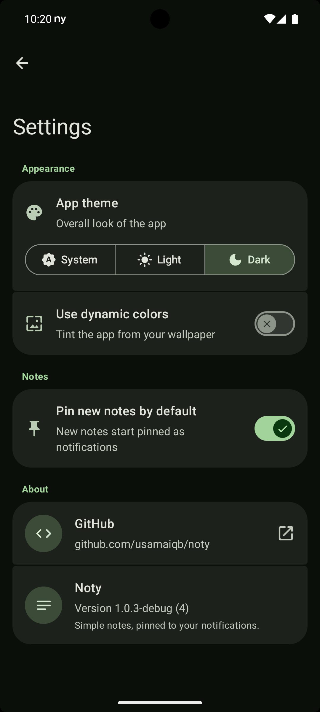

# Noty — Notes in Your Notification Shade

<p align="center">
  <a href="https://github.com/usamaiqb/noty/actions/workflows/ci.yml"></a>
  <a href="https://github.com/usamaiqb/noty/releases"></a>
  <a href="https://f-droid.org/packages/com.noty.app/"></a>
  <a href="https://www.gnu.org/licenses/gpl-3.0"></a>
</p>

Keep your notes exactly where you look dozens of times a day: pinned as notifications in your status bar. No ads, no tracking, no accounts, and no internet access.

<p align="center">
  <a href="https://f-droid.org/packages/com.noty.app/"></a>
</p>

Download the latest APK from the [Releases](https://github.com/usamaiqb/noty/releases) page.

## Help test on Google Play

We're working on getting Noty published on Google Play. The app is already available there in **closed testing**, and we need real users trying it out to get it fully published.

1. Join the [Google Group](https://groups.google.com/g/noty-testers) (approval may take a few minutes)
2. Once approved, [opt in as a tester](https://play.google.com/apps/testing/noty.app)
3. [Install the app](https://play.google.com/store/apps/details?id=noty.app) and open it a few times over the next two weeks

<p align="center">
  <a href="https://play.google.com/apps/testing/noty.app"></a>
</p>

Thank you! This helps us reach far more users than F-Droid and GitHub alone.

## Screenshots

<p align="center">
  
  
  
  
  
</p>

## Features

### Notes

- **Persistent notifications** - Every pinned note stays in your status bar until you're done with it
- **Pin or unpin anytime** - Choose which notes appear as notifications; unpinned notes stay in the app
- **Survives restarts** - Notes and reminders are restored automatically after a phone restart
- **Add, edit, delete** - Give a note a title and an optional description, and edit or delete it with a tap
- **Search** - Filter notes by title or description
- **Reminders** - Set a one-time date and time reminder on any note

### App

- **Quick Settings tile** - Add a "Quick Note" tile to jump straight to the add-note screen
- **Material You** - Material 3 with dynamic color on Android 12+, plus Light, Dark, and System themes
- **Settings** - Choose the theme, toggle dynamic color, and decide whether new notes start pinned
- **Fully private** - Notes are stored only on your device and never leave it

## Requirements

- Android 8.0 (Oreo) or higher

## Verification

Builds from this repository and F-Droid are signed with the same key. Verify the signing certificate rather than the APK file hash, since file hashes can differ between distributions while the certificate stays the same.

- **Package:** `com.noty.app`
- **Certificate SHA-256:** `C1:12:91:80:4C:FF:F1:C4:DF:08:BD:52:37:92:F6:4C:84:E0:3C:27:6A:B4:77:32:D9:FC:3E:3F:62:F7:8D:92`

Check it with an on-device verifier app, or `apksigner verify --print-certs <apk>`, which prints the same value in lower case without colons.

<details>
<summary><h2>Permissions</h2></summary>

- **POST_NOTIFICATIONS** - To show your notes as persistent notifications
- **RECEIVE_BOOT_COMPLETED** - To restore notes and reschedule reminders after a phone restart
- **FOREGROUND_SERVICE** / **FOREGROUND_SERVICE_SPECIAL_USE** - To keep pinned notes visible as notifications in the background
- **SCHEDULE_EXACT_ALARM** - To deliver reminders at the exact time you set

Noty has no internet permission and no location permission.

</details>

## Building

Requires JDK 17 and the Android SDK (API 36).

```bash
git clone https://github.com/usamaiqb/noty.git
cd noty
./gradlew assembleDebug
```

The APK is written to `app/build/outputs/apk/debug/`. See [CHANGELOG.md](CHANGELOG.md) for version history.

## Contributing

Contributions are welcome. Use [Issues](https://github.com/usamaiqb/noty/issues) or [Discussions](https://github.com/usamaiqb/noty/discussions) for bugs and questions.

## License

[GNU General Public License v3.0](LICENSE). See the [Privacy Policy](PRIVACY_POLICY.md) for how the app handles data.
